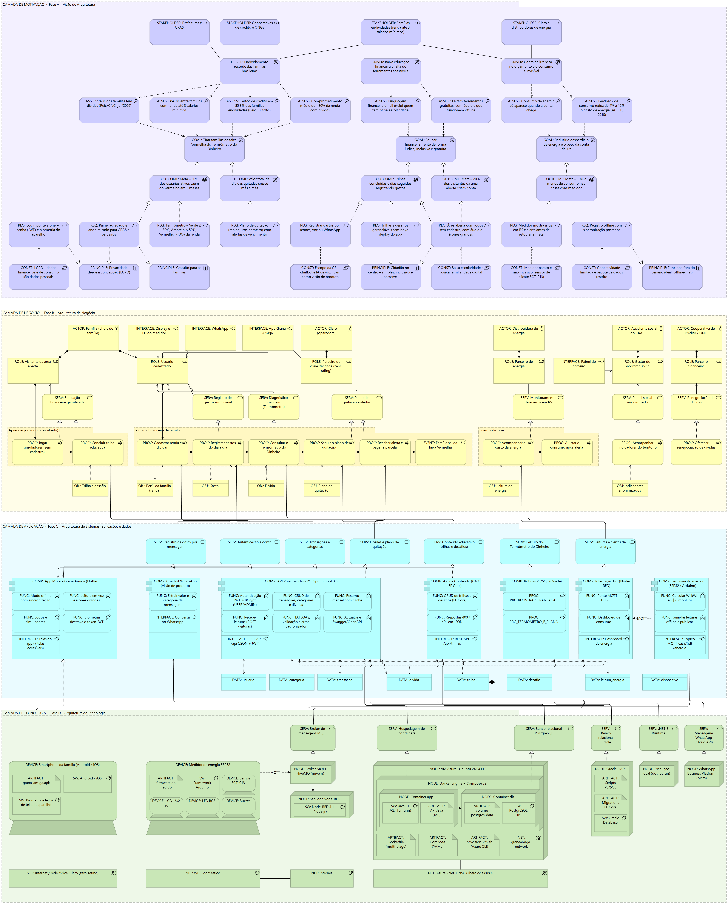
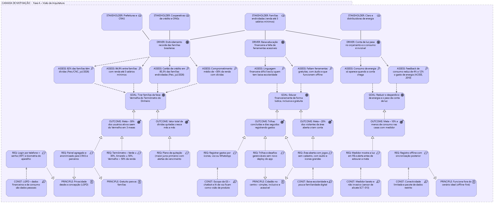
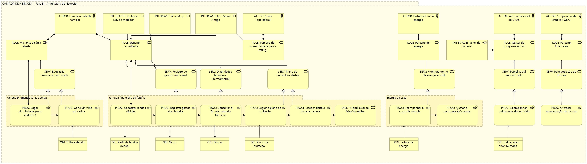
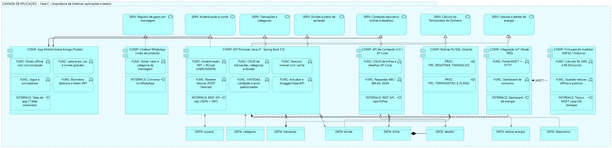
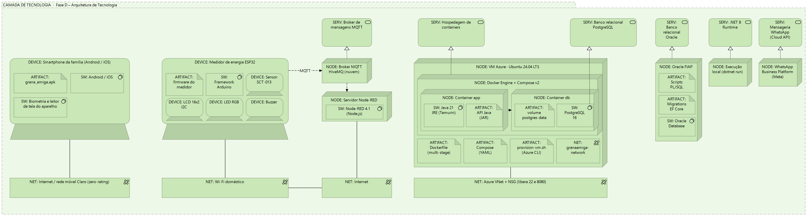

# Grana Amiga – Compliance, Quality Assurance & Tests

**Global Solution 2026/2 · FIAP · CitizenTech – Serviços e direitos**

Arquitetura de Soluções da **Grana Amiga** desenvolvida com o **TOGAF ADM** (Fase Preliminar até a Fase D) e modelada em **ArchiMate** na ferramenta **[Archi](https://www.archimatetool.com/)**.

A Grana Amiga é uma CitizenTech de educação e organização financeira para famílias brasileiras de baixa renda. Em julho de 2026, **82% das famílias tinham dívidas** (recorde da série Peic/CNC), chegando a **84,9%** entre quem ganha até três salários mínimos. O app combina jogos educativos sem cadastro, um *Termômetro do Dinheiro* (Verde, Amarelo, Vermelho) com plano de quitação e um medidor de energia IoT que mostra em reais o custo da conta de luz.

## Integrantes

Turma: **2TDSPR**

| Nome | RM |
|------|----|
| Cassio Ribeiro | 567295 |
| Davi Isac Colin Pereira | 567265 |
| Hugo Souza de Jesus | 568542 |
| Matheus Peres Moraes de Jesus | 567300 |
| Pedro Gonçalves Rodrigues | 567651 |

---

## Entregáveis

| Arquivo | Conteúdo |
|---------|----------|
| [`entrega/GranaAmiga-Documento-Descritivo.pdf`](entrega/GranaAmiga-Documento-Descritivo.pdf) | Documento descritivo da solução (28 páginas) – também em [`.docx`](entrega/GranaAmiga-Documento-Descritivo.docx) |
| [`entrega/GranaAmiga-Arquitetura.archimate`](entrega/GranaAmiga-Arquitetura.archimate) | Modelo do Archi com 5 visões: a completa e uma por camada |
| [`entrega/GranaAmiga-Diagrama-Arquitetura.pdf`](entrega/GranaAmiga-Diagrama-Arquitetura.pdf) | As 5 visões exportadas do Archi em PDF vetorial (alta definição) |
| [`entrega/integrantes.txt`](entrega/integrantes.txt) | Nomes, RMs, turma e conteúdo do `.zip` enviado no portal |

O `.zip` enviado no Portal do Aluno contém exatamente esses arquivos.

### Onde está cada critério de avaliação

| Critério | Pontos | Onde encontrar |
|----------|--------|----------------|
| Visão da Arquitetura – Camada de Motivação | 20 | Documento, cap. 4 · visão `01` |
| Visão de Negócios – Camada de Business | 20 | Documento, cap. 5 · visão `02` |
| Visão de Sistemas – Camada de Aplicação | 20 | Documento, cap. 6 · visão `03` |
| Visão de Infraestrutura – Camada de Tecnologia | 20 | Documento, cap. 7 · visão `04` |
| Nome do projeto, equipe (nome e RM) e desafio | 10 | Capa e cap. 1 |
| Público-alvo e estimativa de impacto com dados de mercado | 10 | Cap. 2 |

O capítulo 8 traz a **visão integrada** e uma tabela de **rastreabilidade** (requisito → negócio → aplicação → tecnologia), usada para validar a proposta de arquitetura.

---

## Arquitetura

### Visão completa (Fases A a D)



As quatro camadas aparecem empilhadas. Os serviços de aplicação **servem** os processos de negócio, e os serviços de tecnologia **servem** os componentes de aplicação. As linhas entre camadas foram roteadas por corredores livres para não atravessar outros elementos.

### Fase A – Motivação



Stakeholders (famílias, CRAS, cooperativas e ONGs, Claro e distribuidoras) → direcionadores (endividamento recorde, baixa educação financeira, conta de luz invisível) → avaliações com dados da Peic/CNC e da ACEEE → objetivos → resultados com metas mensuráveis. Embaixo ficam os requisitos e, perto deles, os princípios (cidadão no centro, privacidade/LGPD, gratuidade, offline-first) e as restrições que os limitam.

### Fase B – Negócio



Atores e canais → papéis → serviços de negócio → processos agrupados em três jornadas da família (*Aprender jogando*, *Jornada financeira* e *Energia da casa*) e nos processos dos parceiros (CRAS e cooperativas) → objetos de negócio.

### Fase C – Aplicação



Serviços de aplicação no topo, componentes com suas funções e interfaces no meio e objetos de dados embaixo. Os componentes são os entregáveis das outras disciplinas: App Flutter, API Principal (Java/Spring Boot), API de Conteúdo (ASP.NET Core), rotinas PL/SQL, integração IoT (Node-RED) e firmware do medidor (ESP32). O chatbot de WhatsApp aparece como visão de produto.

### Fase D – Tecnologia



VM Azure com Docker Engine e os containers `app` e `db`, Oracle da FIAP, execução local da API .NET, broker MQTT, servidor Node-RED, smartphone da família e medidor ESP32, além das redes (rede móvel Claro, Wi-Fi doméstico e Azure VNet + NSG).

---

## Estrutura do repositório

```
.
├── README.md
├── entrega/                 ← arquivos enviados no portal
│   ├── GranaAmiga-Documento-Descritivo.pdf
│   ├── GranaAmiga-Documento-Descritivo.docx
│   ├── GranaAmiga-Arquitetura.archimate
│   ├── GranaAmiga-Diagrama-Arquitetura.pdf
│   └── integrantes.txt
├── diagramas/               ← visões exportadas do Archi em PNG (usadas neste README)
└── fonte/                   ← scripts que geram o modelo, o documento e o .zip
    ├── gerar_modelo.py      ← cria o .archimate (elementos, relações, visões e rotas das linhas)
    ├── render_preview.py    ← preview aproximado das visões, sem precisar abrir o Archi
    ├── gerar_documento.js   ← cria o documento descritivo (.docx)
    ├── montar_entrega.py    ← documento em PDF, junta os PDFs das visões e cria o .zip
    └── package.json
```

---

## Como abrir o modelo

1. Instale o **Archi** (gratuito): <https://www.archimatetool.com/download/>.
2. **File → Open** e escolha [`entrega/GranaAmiga-Arquitetura.archimate`](entrega/GranaAmiga-Arquitetura.archimate).
3. Em **Views**, dê **dois cliques** numa das visões (`00` a `04`). **Ctrl+Shift+Z** enquadra o diagrama inteiro.
4. Clique num elemento para ver os detalhes (portas, versões, regras de cálculo, responsáveis) no campo **Documentation** da aba **Properties**.

**Validação:** o modelo passa no **Validator** do Archi (*Window → Validator → Validate*) **sem erros**. Os avisos do tipo *Unused Relation* são esperados: são relações guardadas no modelo para rastreabilidade (por exemplo, função de aplicação → requisito) e as relações de elementos desenhados uns dentro dos outros, que o Archi não desenha como linha.

---

## Como reproduzir os arquivos

O modelo e o documento são gerados por script, o que deixa o conteúdo versionado e fácil de revisar no Git.

### Pré-requisitos

- Python 3.12+ com `pymupdf` e `pillow` (`pip install pymupdf pillow`)
- Node.js 20+
- LibreOffice (para converter o documento em PDF)
- Archi (para exportar as visões)

> O `render_preview.py` usa as fontes Arial e Segoe UI do Windows. Ele é opcional: serve só para conferir o layout sem abrir o Archi.

### Passo a passo

```bash
# 1. Gerar o modelo ArchiMate (e o preview das visões)
python fonte/gerar_modelo.py build
python fonte/render_preview.py build

# 2. Abrir build/GranaAmiga-Arquitetura.archimate no Archi e exportar cada visão
#    (File → Export → View As Image) em PNG (escala 200%) e em PDF,
#    salvando em build/archi/ com os nomes sugeridos pelo Archi.

# 3. Instalar a dependência do gerador de documento
cd fonte && npm install && cd ..

# 4. Gerar documento (DOCX + PDF), juntar os PDFs das visões e criar o .zip
python fonte/montar_entrega.py build build/entrega
```

O resultado fica em `build/entrega/`, que está no `.gitignore`.

---

## Decisões de modelagem

- **Prefixo no nome de cada elemento** (`DRIVER:`, `GOAL:`, `PROC:`, `COMP:`, `NODE:`…), seguindo o padrão usado em aula, para o PDF ser legível sem conhecer todos os ícones.
- **Uma visão completa e quatro por camada:** a completa mostra a integração, e as visões por camada são as usadas no documento e na apresentação.
- **Detalhes técnicos na documentação dos elementos**, e não no rótulo, para os títulos caberem nas caixas e o diagrama continuar limpo.
- **Visão de produto explícita:** o chatbot de WhatsApp e o painel B2G fazem parte da arquitetura-alvo, mas não são implementados nesta GS. Isso está registrado como restrição no próprio modelo.
- **Dados conferidos na fonte:** Peic/CNC de julho de 2026 (82% endividadas; 84,9% até 3 SM; cartão em 85,3%) e ACEEE Report E105 (feedback de consumo reduz de 4% a 12% o gasto de energia).

---

## Referências

- CNC – Peic de julho de 2026: [Sou Brasília](https://soubrasilia.com/endividamento-familias-82-por-cento-julho-2026-peic-cnc-recorde/), [Gazeta SP](https://www.gazetasp.com.br/economia/endividamento-familiar-atinge-60-milhoes-de-lares-em-julho-e-bate-6o-recorde-seguido-no-pais-aponta-cnc/), [Mercado & Consumo](https://mercadoeconsumo.com.br/06/08/2026/noticias/cnc-endividamento-das-familias-sobe-para-82-mas-inadimplencia-cai/)
- Ehrhardt-Martinez, Donnelly e Laitner – [ACEEE Report E105 (2010)](https://www.aceee.org/research-report/e105)
- The Open Group – [TOGAF Standard](https://pubs.opengroup.org/togaf-standard/index.html) e [ArchiMate 3.1](https://pubs.opengroup.org/architecture/archimate3-doc/)
- [Archi](https://www.archimatetool.com/)

### Outros repositórios da solução

- [Java Advanced](https://github.com/grana-amiga/Java-Advanced) · [Advanced Business Development with .NET](https://github.com/grana-amiga/Advanced-Business-Development-with-.NET) · [Mastering Relational and Non-Relational Database](https://github.com/grana-amiga/Mastering-Relational-and-Non-Relational-Database)
- [Mobile Application Development](https://github.com/grana-amiga/Mobile-Application-Development) · [DevOps Tools & Cloud Computing](https://github.com/grana-amiga/DevOps-Tools_Cloud-Computing) · [IoT](https://github.com/grana-amiga/IoT-IOB-Generative-IA)

---

## Uso de IA generativa

O grupo usou o **Claude (Anthropic)** como apoio para estruturar o documento descritivo, gerar o arquivo do modelo ArchiMate por script e revisar a consistência entre as camadas. Os dados de mercado foram conferidos nas fontes citadas. O modelo foi aberto, conferido e validado no Archi pelos integrantes, e o grupo responde por todas as decisões de arquitetura.

---

Projeto acadêmico da Global Solution 2026/2 (FIAP), tema **CitizenTech — Tecnologia com o cidadão no centro da inovação**.
